 

### Main skills:

  
  
  
  
  
  
  
  
  
  
  
  
  
  
  
  
  

 

### Studying at the moment:

  
  
  
  
  

  

###

  
  

###

###

 
 

  <picture>
    <source media="(prefers-color-scheme: dark)" srcset="https://raw.githubusercontent.com/SamucaFront/SamucaFront/output/pacman-contribution-graph-dark.svg">
    <source media="(prefers-color-scheme: light)" srcset="https://raw.githubusercontent.com/SamucaFront/SamucaFront/output/pacman-contribution-graph.svg">
    
  </picture>

